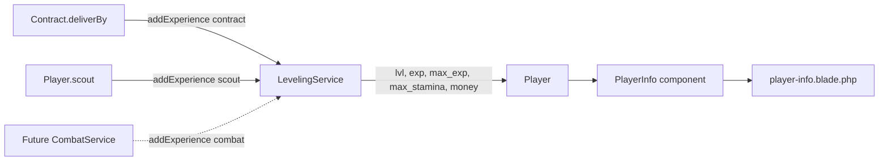

# Requirements

### Overview & Goals
Поточна система рівнів гравця (`Player::lvl`, `exp`, `max_exp`) по суті не працює: досвід (`exp`) ніде в коді не нараховується, а кнопка "Level Up" (`PlayerController::levelUp`) лише перевіряє `exp >= max_exp` і дає фіксовану винагороду. Мета — зробити систему рівнів повноцінною: гравець реально отримує exp за ігрові дії, рівень підвищується автоматично, а підвищення рівня дає відчутні й збалансовані бонуси.

### Scope
**В межах:**
- Нарахування exp за доставку контрактів (`Contract::deliverBy`) та розвідку ресурсів (`Player::scout`).
- Централізований сервіс для нарахування exp та автоматичного левел-апу (підтримка кількох рівнів за один стрибок exp).
- Нова (поміркована) формула зростання порогу `max_exp` замість `*1.75`.
- Винагороди за рівень: приріст `max_stamina` + грошова винагорода.
- Публічний API сервісу, готовий до підключення майбутньої бойової системи як джерела exp (саму бойову систему не реалізовуємо — її ще не існує в проєкті).
- Оновлення UI (`player-info.blade.php`) — прибрати захардкоджену `$temp_exp = 50`, показувати реальний прогрес і сповіщення про левел-ап.
- Видалення ручної кнопки/роуту "Level Up", оскільки рівень тепер підвищується автоматично.

**Поза межами:**
- Реалізація самої бойової системи (зброя/вагони зброї вже є в моделях, але логіки бою немає).
- Дерево навичок / розподіл очок характеристик гравцем вручну.
- Мультиплеєрні/PvP аспекти рівня.

### User Stories
- Як гравець, я хочу отримувати досвід за доставку контрактів, щоб моя активність у грі відчутно впливала на прогрес персонажа.
- Як гравець, я хочу отримувати (невеликий) досвід за розвідку ресурсів, щоб рутинні дії теж давали прогрес.
- Як гравець, я хочу, щоб рівень підвищувався автоматично, щойно накопичено достатньо досвіду, без необхідності натискати додаткову кнопку.
- Як гравець, я хочу бачити реальний прогрес-бар досвіду та отримувати повідомлення про підвищення рівня.
- Як гравець, я хочу, щоб підвищення рівня давало відчутну користь (більше витривалості, гроші), а не просто змінювало число.

### Functional Requirements
- Кожне джерело exp (контракт, розвідка) передає в сервіс кількість exp та джерело (для майбутньої аналітики/балансу).
- Якщо після нарахування `exp >= max_exp`, рівень підвищується автоматично; якщо нарахованого exp вистачає на кілька рівнів одразу — всі вони застосовуються в одному виклику (цикл left-over exp переноситься на наступний рівень).
- При кожному підвищенні рівня: `max_stamina` зростає на фіксовану величину, гравець отримує грошову винагороду, `max_exp` перераховується за новою формулою.
- Ручний роут `POST /player/{player}/levelup` та відповідний контролер/кнопка видаляються — левел-ап більше не є дією користувача.
- UI (`player-info.blade.php`) показує справжній `%` прогресу (вже обчислюється в `PlayerInfo::calculateProgress()`, але значення перекривається захардкодженою змінною `$temp_exp`) та flash-повідомлення "Level up!" коли стається підвищення рівня.

# Technical Design

### Current Implementation
- `App\Models\Player` зберігає `lvl`, `exp`, `max_exp`; має `canLevelUp(): bool` (`exp >= max_exp`), але жодного методу для нарахування exp.
- `App\Http\Controllers\PlayerController::levelUp()` — ручна дія: `lvl++`, `exp -= max_exp`, `max_exp = ceil(max_exp * 1.75)`, `money += 500`. Викликається через роут `player.levelup` (`routes/web.php`).
- `App\Models\Contract::deliverBy()` при успішній доставці викликає лише `$player->addMoney($this->reward)` — exp не нараховується.
- `App\Models\Player::scout()` успішно додає ресурси у вагони, але також не нараховує exp.
- `App\View\Components\PlayerInfo` коректно рахує `$progress`, але `resources/views/components/player-info.blade.php` містить `$temp_exp = 50;` — захардкоджене значення замість реального прогресу.
- У проєкті вже є прецедент виносу складної логіки в окремі сервіси: `App\Services\TravelService`, `App\Services\ShopSellService`, `App\Services\PlayerSetupService` (підключаються через `app(...)` або DI в контролерах).
- Бойової системи / квестів у проєкті немає (`Weapon`, `WeaponWagon` існують лише як предмети спорядження).

### Key Decisions
1. **Централізований `App\Services\LevelingService`** — вся логіка нарахування exp і левел-апу живе в одному сервісі (а не розмазана по `Player`, `Contract` тощо), за аналогією з `TravelService`/`ShopSellService`. Викликається з `Contract::deliverBy()` та `Player::scout()` через `app(LevelingService::class)`.
2. **Джерела exp на старті:** доставка контракту (`source = 'contract'`) та розвідка (`source = 'scout'`). Параметр `$source` закладається в сигнатуру методу з самого початку, щоб у майбутньому бойова система могла викликати той самий метод без зміни контракту сервісу.
3. **Автоматичний левел-ап** замість ручної кнопки — `LevelingService::addExperience()` сам виконує цикл `while ($player->exp >= $player->max_exp) { levelUp($player); }`, підтримуючи стрибок на кілька рівнів одразу.
4. **Поміркована формула зростання порогу:** `max_exp(lvl) = (int) round(100 * $lvl ** 1.3)` замість `*1.75` — плавніше зростання складності, легше збалансувати на пізніх рівнях.
5. **Винагороди за рівень:** `max_stamina += 5` та грошова винагорода `money += 100 + $newLvl * 50` (наростає з рівнем, замість фіксованих 500).
6. **Розмір exp за дію:**
   - Контракт: `exp = max(10, (int) floor($contract->reward / 2))` — пропорційно нагороді/складності контракту.
   - Розвідка: фіксований невеликий `exp` (константа `LevelingService::SCOUT_EXP_REWARD = 3`) за кожен успішний виклик `scout()`.

### Proposed Changes
- Створити `App\Services\LevelingService` з публічним методом `addExperience(Player $player, int $amount, string $source): LevelUpResult` (або простіше — `array`/DTO з переліком досягнутих рівнів), який інкапсулює формулу порогу, цикл левел-апів і видачу винагород, і зберігає гравця (`$player->save()`).
- У `Contract::deliverBy()` після `$player->addMoney($this->reward)` додати виклик `app(LevelingService::class)->addExperience($player, $expAmount, 'contract')`.
- У `Player::scout()` після успішного додавання ресурсів (`$totalAdded > 0`) додати виклик `app(LevelingService::class)->addExperience($this, LevelingService::SCOUT_EXP_REWARD, 'scout')`.
- Видалити `PlayerController::levelUp()`, роут `player.levelup` та кнопку "Level Up" у відповідному Blade-шаблоні (`player/index.blade.php`), а також `Player::canLevelUp()`, якщо він більше ніде не використовується.
- Виправити `resources/views/components/player-info.blade.php`: прибрати `$temp_exp`, використовувати передану властивість `$progress`, додати відображення flash-повідомлення про левел-ап (`session('levelup_message')` або подібний флеш-ключ, який встановлює `LevelingService`/контролер після виклику).

### Data Models / Contracts
```php
namespace App\Services;

class LevelingService
{
    public const SCOUT_EXP_REWARD = 3;
    public const BASE_MAX_EXP = 100;
    public const EXP_CURVE_EXPONENT = 1.3;
    public const STAMINA_GAIN_PER_LEVEL = 5;

    /**
     * Add experience to the player and process any resulting level-ups.
     * Returns the number of levels gained (0 if none).
     */
    public function addExperience(Player $player, int $amount, string $source): int;

    protected function calculateMaxExp(int $level): int;

    protected function applyLevelUp(Player $player): void; // lvl++, max_stamina += X, money += Y, max_exp = calculateMaxExp(newLvl)
}
```
Жодних змін схеми БД не потрібно — усі задіяні поля (`lvl`, `exp`, `max_exp`, `max_stamina`, `money`) вже існують у таблиці `players`.

### Architecture Diagram


### File Structure
- **Added:** `app/Services/LevelingService.php`
- **Modified:** `app/Models/Contract.php` (`deliverBy`), `app/Models/Player.php` (`scout`, removal of `canLevelUp`), `app/Http/Controllers/PlayerController.php` (remove `levelUp`), `routes/web.php` (remove `player.levelup` route), `resources/views/components/player-info.blade.php`, relevant player view with the "Level Up" button (e.g. `resources/views/player/index.blade.php`).

### Risks
- **Баланс складно оцінити без реальних даних** — запропоновані числові константи (exp за контракт/розвідку, приріст stamina, грошова винагорода) є відправною точкою й можуть вимагати донастройки після тестування.
- **Відсутність бойової системи** означає, що третє джерело exp ("combat") не може бути підключене зараз — сервіс лише готовий прийняти його в майбутньому через параметр `$source`.
- **Видалення ручного левел-апу** — якщо десь ще використовується `Player::canLevelUp()` або роут `player.levelup` (наприклад, у тестах), ці місця потрібно буде прибрати/оновити разом.

# Testing

### Validation Approach
Перевірка виконується через Feature-тести Laravel (за зразком наявного `tests/Feature/PlayerWagonTest.php`) для `LevelingService`, `Contract::deliverBy()` та `Player::scout()`.

### Key Scenarios
- Виклик `LevelingService::addExperience()` з кількістю exp, що перевищує `max_exp`, підвищує `lvl` на 1, переносить залишок exp, перераховує `max_exp` за новою формулою, збільшує `max_stamina` і `money`.
- Виклик з дуже великою кількістю exp (достатньою на 2+ рівні) підвищує `lvl` відразу на кілька одиниць, застосовуючи винагороду за кожен пройдений рівень.
- Успішна дост��вка контракту (`Contract::deliverBy`) нараховує exp відповідно до `reward` контракту та, за потреби, викликає левел-ап.
- Успішний виклик `Player::scout()` нараховує фіксований `SCOUT_EXP_REWARD`.

### Edge Cases
- Нарахування exp, якого недостатньо для левел-апу — `lvl` не змінюється, `exp` просто зростає.
- Невдала доставка контракту / невдала розвідка (`scout()` повертає `false`) — exp не нараховується.
- Маршрут `player.levelup` більше недоступний (404) і не викликається з UI.

# Delivery Steps

### * Step 1: Реалізувати LevelingService з формулою досвіду та авто-левел-апом
Створено `App\Services\LevelingService`, який централізовано керує нарахуванням exp та підвищенням рівня.
- Додати клас `app/Services/LevelingService.php` з методом `addExperience(Player $player, int $amount, string $source): int`.
- Реалізувати нову формулу порогу `max_exp(lvl) = round(100 * lvl ** 1.3)` замість `*1.75`.
- Реалізувати цикл автоматичного левел-апу (підтримка підвищення на кілька рівнів за один виклик, з перенесенням залишку exp).
- У кожному левел-апі застосовувати винагороди: `max_stamina += 5`, `money += 100 + newLvl * 50`.
- Прибрати `Player::canLevelUp()`, якщо він більше не використовується.

### ✓ Step 2: Підключити нарахування exp до доставки контрактів та розвідки
Гравець реально отримує досвід за ключові ігрові дії.
- У `Contract::deliverBy()` після `$player->addMoney($this->reward)` викликати `LevelingService::addExperience()` з `exp = max(10, floor(reward / 2))` та `source = 'contract'`.
- У `Player::scout()` після успішного додавання ресурсів викликати `LevelingService::addExperience()` з фіксованим `SCOUT_EXP_REWARD` та `source = 'scout'`.
- Переконатись, що exp не нараховується при невдалій доставці/розвідці.

### ✓ Step 3: Видалити ручний Level Up та оновити UI прогресу досвіду
Рівень гравця більше не підвищується вручну; інтерфейс показує реальний прогрес та сповіщення про левел-ап.
- Видалити `PlayerController::levelUp()`, роут `player.levelup` у `routes/web.php` та кнопку "Level Up" у відповідному Blade-шаблоні.
- Виправити `resources/views/components/player-info.blade.php`: прибрати захардкоджену `$temp_exp = 50` та використовувати реальну властивість `$progress`.
- Додати flash-повідомлення про підвищення рівня, яке встановлюється після виклику `LevelingService::addExperience()` у `PlayerController::scout()` та в контролері доставки контрактів.

### ✓ Step 4: Покрити нову систему рівнів тестами
Feature-тести підтверджують коректність нарахування exp, формули порогу та винагород за рівень.
- Додати тести для `LevelingService::addExperience()`: звичайний левел-ап, стрибок на кілька рівнів, недостатньо exp для левел-апу.
- Додати/оновити Feature-тест доставки контракту, що перевіряє нарахування exp та (за потреби) левел-ап.
- Додати тест на `Player::scout()`, що перевіряє нарахування фіксованого exp за успішну розвідку.�.