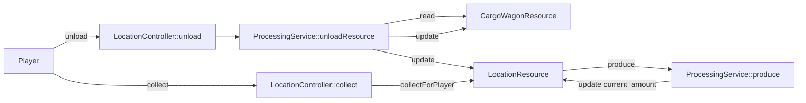

# Requirements

### Overview & Goals
Додати систему переробки ресурсів T0 → T1 на T1 локаціях (лісопильні, плавильні тощо). Гравець доставляє сировину T0 на локацію, вивантажує її, і виробництво T1 починається з часом.

### User Stories
- As a player, I want to unload T0 resources from my wagons at a T1 location so that production of T1 resources starts.
- As a player, I want to see how much T1 is being produced and when it will be ready.
- As a player, I want to collect T1 resources when production is complete.

### Scope
**In Scope:**
- T1 локації (9 типів): Sawmill, Iron Smelter, Coking Plant, Flour Mill, Copper Smelter, Masonry, Oil Refinery, Brickworks, Glassworks
- Ручне вивантаження T0 з вагонів на локацію
- Виробництво T1 з часом після вивантаження T0
- Відображення стану виробництва на сторінці локації
- Collect T1 ресурсів у вагони

**Out of Scope:**
- T2 ресурси
- Зміни в T0 локаціях (шахти, ферми)
- Автоматичне вивантаження
- Крафт за витривалість

### Processing Ratios
| T0 → T1 | Пропорція | Приклад |
|---|---|---|
| Wood → Planks | 1→2 | 10 Wood = 20 Planks |
| Iron Ore → Iron Ingot | 2→1 | 10 Iron Ore = 5 Iron Ingot |
| Coal → Coke | 1→1 | 10 Coal = 10 Coke |
| Grain → Flour | 1→2 | 10 Grain = 20 Flour |
| Copper Ore → Copper Ingot | 2→1 | 10 Copper Ore = 5 Copper Ingot |
| Stone → Stone Bricks | 1→2 | 10 Stone = 20 Stone Bricks |
| Crude Oil → Refined Oil | 1→1 | 10 Crude Oil = 10 Refined Oil |
| Clay → Bricks | 1→2 | 10 Clay = 20 Bricks |
| Sand → Glass | 1→2 | 10 Sand = 20 Glass |

# Technical Design

### Current Implementation
- **LocationResource** — `produce()` метод виробляє ресурси з часом (`production_rate_per_hour`), `collectForPlayer()` збирає в вагони
- **CargoWagonResource** — зберігає ресурси в вагонах (`cargo_wagon_id`, `resource_id`, `quantity`)
- **LocationController** — `show()`, `collect()`, `refuel()` методи
- **config/locations.php** — 18 типів локацій, кожна має `produces` поле (slug ресурсу)
- **config/resource.php** — 18 ресурсів, T1 мають `produced_from` поле (slug T0 ресурсу)

### Key Decisions
1. **Вивантаження = початок виробництва**: Гравець вивантажує T0 з вагонів, T0 миттєво перетворюється на «час виробництва» T1. Не зберігаємо T0 окремо — одразу рахуємо скільки T1 буде вироблено.
2. **Пропорції в config/resource.php**: Додати `processing_ratio` поле для T1 ресурсів (наприклад, `['input' => 1, 'output' => 2]` для Planks).
3. **input_resource в location_resources**: Додати `input_resource_id` колонку — посилання на T0 ресурс, який потрібен для виробництва.
4. **processing_queue в location_resources**: Додати `processing_amount` (скільки T1 очікує виробництва) та `processing_started_at` (коли почалося).

### Database Changes
**`location_resources` таблиця — нові колонки:**
- `input_resource_id` (integer, nullable) — посилання на T0 ресурс (для T1 локацій)
- `processing_ratio_input` (integer, default 1) — скільки одиниць T0 потрібно
- `processing_ratio_output` (integer, default 1) — скільки одиниць T1 виходить
- `processing_amount` (integer, default 0) — скільки T1 очікує виробництва
- `processing_started_at` (timestamp, nullable) — коли почалося виробництво

### Service Layer
**`ProcessingService`** — новий сервіс для логіки переробки:
- `unloadResource(Player $player, Location $location, int $amount)` — вивантажити T0 з вагонів, запустити виробництво T1
- `calculateOutput(int $inputAmount, int $ratioInput, int $ratioOutput)` — розрахувати скільки T1 буде вироблено
- `produce(LocationResource $locationResource)` — оновити виробництво T1 з часом (інтеграція з існуючим `produce()`)
- `getProcessingStatus(LocationResource $locationResource)` — отримати статус виробництва для UI

### Controller Changes
**`LocationController`** — новий метод:
- `unload(Request $request, Location $location)` — обробка вивантаження T0 з вагонів

**`LocationController::show()`** — оновлення:
- Додати `$processingStatus` для T1 локацій
- Додати список T0 ресурсів у вагонах гравця для вивантаження

### View Changes
**`locations/show.blade.php`** — новий блок для T1 локацій:
- Відображення поточного виробництва (progress bar)
- Форма вивантаження T0 з вагонів (select + input + button)
- Відображення доступних T0 ресурсів у вагонах гравця

### Architecture Diagram

### File Structure
- **New:** `app/Services/ProcessingService.php`
- **Modified:** `app/Models/LocationResource.php` — нові поля, оновлений `produce()`
- **Modified:** `app/Http/Controllers/LocationController.php` — `unload()` метод, оновлений `show()`
- **Modified:** `resources/views/locations/show.blade.php` — UI для вивантаження та виробництва
- **Modified:** `config/resource.php` — `processing_ratio` для T1 ресурсів
- **New:** `database/migrations/xxxx_add_processing_to_location_resources.php`
- **Modified:** `resources/lang/en/location.php` та `uk/location.php` — нові ключі

# Testing

### Validation Approach
Перевірка синтаксису PHP для всіх змінених файлів.

### Key Scenarios
1. Гравець вивантажує 10 Wood на Sawmill → має отримати 20 Planks після виробництва
2. Гравець вивантажує 10 Iron Ore на Iron Smelter → має отримати 5 Iron Ingot
3. Гравець не має T0 ресурсів у вагонах → не може вивантажити
4. Гравець намагається вивантажити неправильний ресурс → помилка
5. Виробництво йде з часом → collect() збирає тільки вироблене

### Edge Cases
- Гравець вивантажує під час активного виробництва → додати до черги
- Вагон не має потрібного ресурсу → помилка
- Локація не T1 тип → вивантаження недоступне
- Максимальна місткість локації → обмежити виробництво

# Delivery Steps

### ✓ Step 1: Database migration and config
Додати нові колонки в location_resources та оновити config/resource.php з пропорціями переробки.
- Створити міграцію `add_processing_to_location_resources.php` з колонками: `input_resource_id`, `processing_ratio_input`, `processing_ratio_output`, `processing_amount`, `processing_started_at`
- Оновити `config/resource.php` — додати `processing_ratio` поле для 9 T1 ресурсів
- Оновити `LocationSeeder` — встановити `input_resource_id` для T1 локацій на основі `produced_from` з ресурсів

### ✓ Step 2: ProcessingService
Створити ProcessingService з логікою вивантаження та виробництва.
- `unloadResource()` — перевірка T0 ресурсів у вагонах, зменшення quantity, розрахунок T1 output, оновлення processing_amount та processing_started_at
- `calculateOutput()` — розрахунок на основі пропорцій
- `produce()` — інтеграція з існуючим LocationResource::produce(), оновлення current_amount з processing_amount
- `getProcessingStatus()` — повернення статусу для UI: processing_amount, estimated_time, current_output

### ✓ Step 3: LocationController and UI
Додати unload() метод в LocationController та оновити UI локації.
- `LocationController::unload()` — валідація request (location, resource_id, amount), виклик ProcessingService, flash повідомлення
- `LocationController::show()` — додати $processingStatus, $availableInputs (T0 ресурси у вагонах)
- `locations/show.blade.php` — новий блок для T1 локацій: форма вивантаження з select ресурсів, progress bar виробництва, кнопка collect для T1
- Додати маршрут `POST /locations/{location}/unload` в `routes/web.php`
- Додати локалізацію: `en/location.php` та `uk/location.php` — ключі для unload, processing, estimated_time тощо